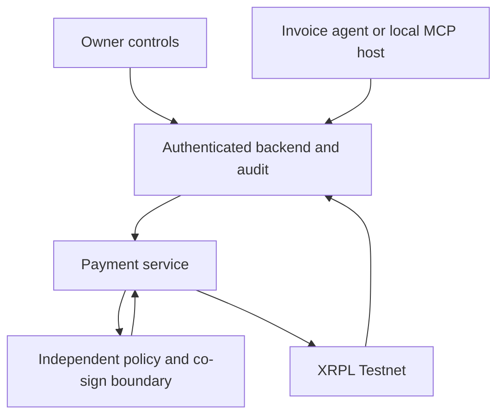

# Shucamoxa technical specification

Version 0.1 draft; 13 November 2026. Read [PRD](PRD.md) for product requirements
and [project status](PROJECT_STATUS.md) for implementation evidence. Existing
shared TypeScript contracts are the integration baseline; deployment and all
target services described below are not assumed to exist.

## 1. Intended architecture and authority

The owner changes mandate state through a separate authorized surface. The agent
has scoped read/propose/payment-request permissions. It does not possess signing
keys, owner permissions or database/service-role credentials. The payment service
constructs transactions from trusted records, not model-supplied destinations.
The policy boundary independently decodes and validates the actual transaction.
The ledger's configured signing rules must make independent authorization
mandatory, so bypassing the usual HTTP route cannot bypass the mandate.

The exact deployed signer topology is **open**. `CosignRequest`/`CosignResponse`
are the current code-level boundary; their presence is not evidence of a working
co-signer or an on-ledger signer list. Record threshold, signer ownership,
revocation and recovery design before implementing the live signing path.

## 2. Repository components

| Path | Purpose |
|---|---|
| `packages/shared/src/` | `@shucamoxa/shared`: Zod schemas, exact money, IDs, policy codes, audit chain and Testnet constants. |
| `services/agent/src/` | Extraction/planning, direct backend tools, model configuration and deterministic outcomes. |
| `services/agent/test/`, `eval/`, `fixtures/invoices/` | Scripted model/fake backend tests, adversarial inputs and demo expectations. |
| `src/w3node/chat.py`, `sandbox_mcp.py` | Terminal development host and local zero-tool/optional echo MCP server. |
| `mcp_gateway/` | Separate Python MCP adapter for a proposed invoice-oriented `/v1` backend. |
| `src/w3node/onboarding.py`, `deploy/` | Local key requests and root-controlled instance onboarding sync/scheduler definitions. |
| `src/w3node/model_build.py`, `model-profiles/`, `model.lock.json` | Development model recipes, import and checksum-pinned component references. |

`services/payments/` now contains a SQLite transfer coordinator and private HTTP
adapter. Its required wallet and independent-policy adapters are not implemented.
W2/W4 invoice APIs, signer deployment and owner dashboard remain separate work.

## 3. Primary internal API baseline

`@shucamoxa/shared` is the schema source of truth. Read current files before
coding; this table is a navigation summary, not a second schema implementation.

| Operation | Baseline | Key constraint |
|---|---|---|
| Read mandate | `GET /rules` -> `Rules` | Cap, budget, spent/reserved/remaining, period start, kill switch, supplier IDs/names. No supplier addresses in agent reads. |
| Resolve approved supplier | `GET /suppliers?q=...` -> `SupplierLookup` | Match ID/name/confidence or `notFound`; no raw destination returned to the agent. |
| Request payment | `POST /payments` with `PayRequest` -> `PayResult` | Strict `{supplierId, amount, invoiceNumber, reason}`; no address, override flag or raw transaction. |
| Propose exception | `POST /approvals` with `ApprovalRequest` -> `ApprovalResponse` | Supplier/payment discriminated payload; result indicates pending, not owner approval. |
| Query audit | `GET /log` with `LogFilter` | Scoped filters; verification requires the full ordered chain, not an arbitrary filtered page. |
| Independent authorization | `POST /cosign` with `CosignRequest` -> `CosignResponse` | Policy checks decoded blob against canonical transaction/request; allow returns a policy-signed blob and `OK`, block returns neither usable signature nor `OK`. |

Owner mutation endpoints, approval-decision endpoints and payment-status polling
routes are **not standardized by these existing contracts**. Define and version
them with their authentication/authorization tests before implementation. An
agent must never receive an owner token simply because an endpoint is missing.

## 4. Separate MCP gateway contract

The Python gateway exposes `get_mandate`, `get_balance`, `get_invoice`,
`pay_invoice`, `get_payment_status` against the legacy invoice routes below, plus
`pay(intent_id)` and `get_transfer_status(intent_id)` against the new transfer
coordinator. The seven tools do not imply that the legacy invoice routes are
implemented by the transfer host.

| Method | Proposed gateway backend route |
|---|---|
| GET | `/v1/mandate` |
| GET | `/v1/balance` |
| GET | `/v1/invoices/{invoice_id}` |
| POST | `/v1/invoices/{invoice_id}/payment` with `{reason}` |
| GET | `/v1/invoices/{invoice_id}/payment` |

It expects stored invoice identity and has different field names and status
vocabulary from `PayRequest`/`PayResult`. Its stable Idempotency-Key is useful,
but the receiving backend must enforce uniqueness and durable reservations.
It does not implement the payment backend or its policy rules.

Before connecting this gateway to W1/W4, choose an explicit adapter or coordinated
API migration and test error/status mapping. In particular, map `validated`,
`unknown` and `pending` conservatively; never map them blindly to `settled`.
Do not run the unconfigured gateway against a real-value backend for a demo.

## 5. Data and financial invariants

- Decimal strings on API boundaries; no exponent syntax, signs or floating-point
  money. Use `toCents`, `fromCents`, `compareAmounts`, `addAmounts` for arithmetic.
  The existing decimal format allows up to 12 integer digits and two decimals.
- Asset identity is currency plus issuer, not ticker text. Signing/submission
  code must refuse networks outside the approved Testnet configuration.
- IDs and names use the shared normalization/validation rules. An invoice number
  may contain `/` and `.`; never interpolate it as a filesystem path.
- Only owner-approved supplier records determine destination/address/tag. An
  invoice address can be evidence for an owner proposal, never a payable override.
- Bind a request to authenticated business scope, invoice version, canonical
  supplier and amount, current mandate version and the audit intent. Final
  database uniqueness/reservation schema remains a design/implementation task.
- An approval should authorize a specific exception or versioned mandate change;
  it is not permission to skip subsequent policy checks.

## 6. Payment state and reconciliation requirements

`services/backend/src/wallet-adapter.ts` provides a coordinator wallet adapter
with durable per-intent tracking and ledger lookup. It depends on a trusted
external signer that must independently enforce the policy permit, revocation,
and source control; no such signer is implemented here. Tests with fake signers
do not establish an independent signing boundary. Unresolved pre-sign claims
remain blocked for manual recovery, including after a restart.

The separate developer-only RLUSD CLI uses two locally saved Testnet wallets,
direct single-signature transfers, and a pre-submission pending record. It blocks
new sends while an outcome is unresolved. It is not the product payment service
and has no independent policy or signing boundary. Its local account credentials
must be isolated from the agent by deployment identity, not merely by file names.

The isolated `pnpm xrpl` developer demonstration creates two disposable Testnet
wallets, funds them from the faucet and sends 1 XRP with a single local signature.
It is not the application payment endpoint or a policy-authorized payment. It
checks the validated transaction and exact fields; an uncertain submission is
reported as unknown with its hash. The later product flow still requires durable
reconciliation, policy enforcement and independent signing authority.

The service must persist an internal operation lifecycle richer than the agent's
three `PayResult` outcomes. The following phases are target semantics, **not a
new finalized API enum**:

| Phase | Meaning / allowed transition |
|---|---|
| Received / validated request | Authenticated, deduplicated intent; no spending authority yet. |
| Blocked / awaiting owner | No signature for a disallowed intent; a later owner decision is separately recorded/revalidated. |
| Reserved / authorized | Budget reserved atomically; exact transaction approved by the independent boundary. |
| Submitted / pending | A signed transaction may be on its way; a hash or preliminary submit result is not final. |
| Unknown | Reconcile by the persisted operation/transaction identity; never blindly resubmit as a new payment. |
| Settled | Validated ledger transaction with success and exact approved fields; durable spend/audit state committed. |
| Rejected / expired | Proven ledger outcome; reservation may be resolved according to that evidence. |

Current constants include a 20-ledger last-ledger window, a 120000 ms reservation
TTL and a rate limit of five co-sign requests per 60000 ms. They are code
baselines, not a guarantee that their enforcement is deployed. **TTL expiration
must trigger reconciliation; it must not release uncertain spending capacity
while the transaction can still validate.** Record policy version at planning and
recheck authoritative policy immediately before signing. A kill-switch change
prevents new authority; it cannot reverse a validated transaction or guarantee
recall of an already submitted signed blob.

## 7. Audit evidence

Use `LogEntry` and event/actor enums from `packages/shared/src/log.ts`. Rows have
sequential `seq`, stored ISO timestamp, operation-related fields, `prevHash` and
`hash`. The shared helper computes SHA-256 over the previous hash plus canonical
JSON of the row without `hash`; that row includes its own `prevHash`.

`verifyChain` expects the full chain in ascending sequence starting at the
genesis hash. It detects malformed rows, gaps, reordering and changed content;
it does **not** by itself detect deletion of the newest suffix. Persist/verify
ledger anchors or another independently retained checkpoint for that limitation.
Implement actual memo construction and enforcement before claiming ledger
anchoring exists. Use the shared memo type/hex helpers and require the encoded
transaction memo to agree with the approved audit intent.

Audit data must not expose wallet secrets, privileged tokens, raw private invoice
documents or unnecessary customer identifiers. Separate owner-facing details
from agent-safe results. A model-generated explanation is not authoritative
evidence that a payment occurred.

## 8. LLM, MCP and model development

Qwen/Ollama is the development inference runtime. Local chat/build/setup default
to `http://127.0.0.1:11434` and `qwen3:1.7b-q4_K_M`. Developer MCP runs locally
over stdio. `OLLAMA_HOST` overrides the default; explicit `--host` takes precedence.
The shared Incus model remains reachable by explicitly selecting the private
SSH tunnel on local 11435. No public Ollama listener is needed.

`w3node model setup` pulls missing base weights and verifies the Ollama manifest
digest against `model-profiles/base-model.lock.json`; matching cached models need
no pull and mismatches fail verification. The initial digest is owner-reported
from the shared server. This identity check does not archive upstream versions.
Git stores the lock, profiles and MCP code; Ollama stores the actual base layers.
The same revision can be set up/built on either endpoint. Setup is explicit,
not a prerequisite automatically enforced before every chat/build.

`w3node chat` is a generic development host, not the completed payment pipeline.
Its default MCP server has zero tools; the demo config enables echo. Tool-call
confirmation is a development safeguard. The product's in-mandate autonomous
payment path must instead be governed by the owner mandate and independent
service/ledger enforcement; terminal approval on every payment does not satisfy
the autonomy acceptance criterion.

The TypeScript agent currently has its own direct backend tools. MCP is a tool
transport, not a model-weight update, wallet or policy engine. XRPL Docs MCP
supplies reference material, not payment signing authority. Gmail, external MCP
servers and paid x402/MPP integrations are not implicitly enabled by this spec.

Profiles change system prompts/inference settings; importing an existing GGUF
changes model bytes used by a development build. Neither performs training.
Git stores source, prompts, profiles, recipes, evaluations and artifact URLs/
checksums; large checkpoints live in a suitable artifact store. A mutable Ollama
tag alone is not an immutable artifact pin. See `docs/local-mcp-chat.md` and
`docs/team-workflow.md` for current command behavior and limitations.

## 9. Wallet integration decision

Privy remains an integration candidate. If selected, implement it behind the
trusted payment/policy boundary, with owner-controlled access and transaction
policies. Prefer transaction-aware policy checks; raw hash signing cannot be
assumed to enforce decoded recipient/amount restrictions. Verify current vendor
support and the mandatory independent-authority property at implementation time.
Do not silently replace the co-sign contract with an unconstrained signing key.

Ghostsig is an interactive passkey-wallet option, not a demonstrated autonomous
server signer in this repo. No wallet account, provider credentials, vendor policy
or ledger signing configuration is claimed by these documentation files.

## 10. Configuration, testing and release evidence

Node: `.nvmrc` / `package.json`; pnpm: pinned `packageManager`. Python: 3.11+;
install `.[chat]` for SDK/terminal integration tests. Keep actual endpoints,
credentials and policy membership in the documented private configuration;
do not use real secrets in example files or test literals.

Required validation is proportional to the changed boundary: schema/unit tests,
agent hostile-model tests, backend authorization/concurrency tests, policy direct
bypass tests, payment reconciliation tests and explicit live Testnet evidence.
CI type checks, secret scanning and local fake-ledger tests are useful but cannot
certify a deployed signer or real settlement. See PRD AC-01 through AC-07.

When changing wire fields/statuses, update the shared contracts, all consumers,
tests and this spec together. Resolve known mismatches in PROJECT_STATUS before
asserting the system is integrated. Do not bypass CI/secret controls to land an
integration. Operational access and payment authority are separate permissions.

## 11. Owner-authorized transfer extension

See `services/payments/README.md` for the authoritative new route table and
`packages/shared/src/transfers.ts` for strict wire schemas. This extension supports
internal registered-wallet transfers and approved people/vendors, with optional
scheduling, independently of the unimplemented invoice `/payments` backend.

The owner authorizes a stored immutable intent via a separate credential. Agent
`pay` receives only `{intentId}`. Scope is derived from server-side credential
mapping; neither a name-search confidence nor an agent-provided address can grant
authority. Owner configuration is the current approved recipient channel.

SQLite atomic transactions deduplicate owner/reference across source accounts,
reserve the owner-wide budget and append hash-linked audit before external calls.
Recipient-specific caps may override the global per-payment cap but never budget
or kill switch. Policy edits retain spent/reserved totals. Five rejected pay
requests in 60 seconds lock the offending authenticated principal's payment
capability until owner unlock. This is not login lockout or semantic threat proof.

Policy permits bind a prepared-payment digest. A final independent wallet/signer
implementation must cryptographically verify this permit and the actual
transaction against current authority before signing. Coordinator-level checks
are not proof that the on-ledger signing topology prevents bypass. Required
adapters have no permissive production default. Receipts are trusted only after
adapter verification of actual Testnet ledger evidence; submit is not settled.

Future intents become scheduled without reserving money; an authenticated host
timer invokes due processing and rechecks policy then. Unknown/submitted state
and reservations persist without TTL release, across process restarts. Lookup
never signs/resubmits. Pre-submit crashes remain unknown for manual recovery if
no submission identity exists. The wallet must persist identity before broadcast.

Audit links use shared canonical hashing. The core checks the existing chain
before new execution; external anchoring, incoming-ledger monitoring, deployment
isolation and legal compliance remain separate requirements. OS read-only tool
code and private payment DB permissions must be enforced at deployment, not by
model instructions. No live transfer, signer or scheduler deployment is claimed.
